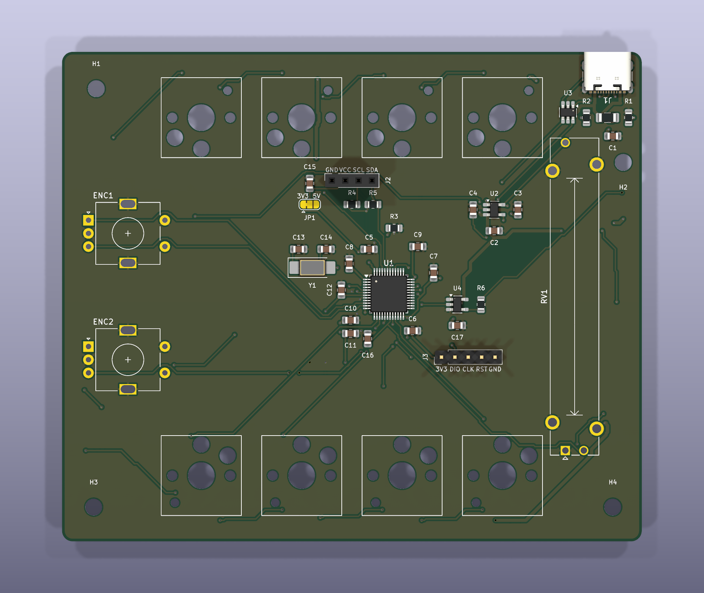

# ChocPilot v2 – płytka (KiCad 10)

Druga wersja sprzętu ChocPilot: 8 klawiszy Kailh Choc V2 w gniazdach hotswap (2 rzędy po 4),
poziomy ekran OLED 2,42" I²C pomiędzy nimi, 2 enkodery EC11 po lewej, suwak 45 mm po prawej,
12 diod WS2812B na spodzie (podświetlenie blatu) i własny mikrokontroler STM32F072 z USB-C.
Płytka 110 × 93 mm, 2 warstwy, wszystko poza elementami istniejącymi tylko w THT – SMD
w obudowach do ręcznego lutowania (0805, SOT-23, LQFP-48).



| Plik | Zawartość |
|---|---|
| `chocpilot-v2.kicad_pro/.kicad_sch/.kicad_pcb` | projekt KiCad 10 (schemat A3, płytka z trasami i wylewkami GND) |
| `chocpilot.pretty/` | footprint własny: Kailh Choc V1/V2 z gniazdem hotswap |
| [bom/BOM.md](bom/BOM.md), [bom/chocpilot-v2-bom.csv](bom/chocpilot-v2-bom.csv) | lista części z numerami TME / Amazon |
| [docs/PINOUT.md](docs/PINOUT.md) | mapa pinów MCU, złącza, kolejność LED |
| [docs/ASSEMBLY.md](docs/ASSEMBLY.md) | kolejność lutowania i uruchomienie |
| [docs/DESIGN_NOTES.md](docs/DESIGN_NOTES.md) | decyzje projektowe, zasilanie, co trzeba zmienić w firmware/aplikacji/obudowie |
| `img/` | podgląd: `schematic.pdf/.png`, `pcb_top/bottom.png` (warstwy), `render_top/bottom.png` (3D) |
| `fab/chocpilot-v2-gerbers.zip` | Gerbery + wiercenia do zamówienia płytek |
| `tools/` | generatory – patrz niżej |

## Dlaczego STM32F072CBT6, a nie RP2040

- **Obudowa.** RP2040 istnieje tylko jako QFN-56 0,4 mm z padem termicznym pod spodem – bez
  gorącego powietrza / pieca praktycznie nie do przylutowania kolbą. STM32F072CBT6 to
  **LQFP-48 0,5 mm z wyprowadzeniami na zewnątrz**: lutuje się zwykłą kolbą metodą „drag”
  z topnikiem, a mostki widać i łatwo zebrać plecionką.
- **Mniej części.** F072 ma USB FS **bez kwarcu** (HSI48 synchronizowany przez CRS z ramkami
  USB), pamięć programu w środku (128 KB) i **bootloader USB DFU w ROM** (BOOT0 + RESET).
  RP2040 wymaga zewnętrznego flasha QSPI (SOIC-8 lub USON), kwarcu 12 MHz i dodatkowego
  odsprzęgania wewnętrznego regulatora 1,1 V.
- **Wystarczająca wydajność.** Firmware v1 mieści się w ATmega32U4 (32 KB flash / 2,5 KB RAM);
  F072 ma 128 KB / 16 KB, sprzętowe I²C, ADC 12-bit, timery z trybem enkodera (TIM2, TIM3)
  i SPI do sterowania WS2812.
- **Dostępność.** STM32F072CBT6 jest w TME, wspierany przez STM32duino (PlatformIO `ststm32`)
  i QMK.

Kwarc 8 MHz (Y1) jest na płytce jako **opcja** – USB go nie potrzebuje; daje dokładniejszy zegar,
jeśli kiedyś będzie potrzebny (można nie lutować Y1, C13, C14).

## Weryfikacja (KiCad 10.0.7, `kicad-cli`)

- **ERC:** 0 błędów, 0 ostrzeżeń.
- **DRC** (`--severity-all --schematic-parity`, także z `--refill-zones`): 0 naruszeń,
  0 niepołączonych, 0 rozbieżności ze schematem.
- Reguły: odstęp miedź–miedź 0,2 mm, ścieżki 0,25 mm (sygnały) / 0,3 mm (+3V3, GND) /
  0,6 mm (VBUS, +5V), przelotki 0,6/0,3 mm, krawędź 0,3 mm (trasowane z 0,5 mm), otwór–miedź
  0,15 mm (kołki ustalające USB-C mają 0,19 mm do padów GND w bibliotecznym footprincie).
  Mieści się w standardzie tanich fabryk (JLCPCB, PCBWay: 2 warstwy, 1,6 mm, 1 oz).

Do zrobienia przed zamówieniem płytek – patrz [DESIGN_NOTES.md](docs/DESIGN_NOTES.md#do-sprawdzenia-przed-zamowieniem):
wydruk 1:1 i przymiarka gniazda Choc, położenie i raster pinów Twojego modułu OLED.

## Generowanie

Schemat, płytka i BOM powstają ze skryptów w `tools/` (dane: [`tools/design.py`](tools/design.py)).
Ręczne poprawki w KiCad są możliwe, ale kolejne generowanie je nadpisze – zmieniaj `design.py`.

```bash
cd pcb/chocpilot-v2
python3 tools/gen_pro.py        # reguły DRC i klasy sieci
python3 tools/gen_sch.py        # schemat
/Applications/KiCad/KiCad.app/Contents/Frameworks/Python.framework/Versions/Current/bin/python3 tools/gen_pcb.py
python3 tools/gen_bom.py        # BOM.md + CSV
tools/render.sh img             # podgląd PNG
tools/export_fab.sh             # Gerbery
```

`gen_pcb.py` używa Pythona dołączonego do KiCad (moduł `pcbnew`), eksportuje netlistę ze
schematu przez `kicad-cli` i trasuje płytkę własnym routerem [`tools/router.py`](tools/router.py)
(A* na siatce 0,25 mm, 2 warstwy; ok. 1 min). `--reuse` używa zapisanych tras z
`tools/build/`. Na macOS `kicad-cli` uruchamiany z piaskownicy potrafi zawisnąć przy starcie –
wtedy trzeba go uruchomić poza nią.
